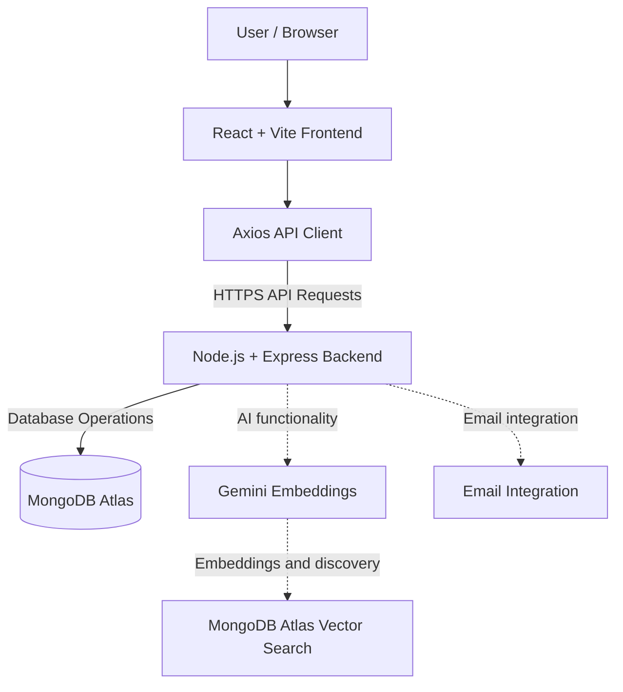

<div align="center">

# Online Library Management System

### A web-based application for book discovery and library workflows

<p>
  
  
  
  
  
</p>

**Discover books. Manage library records. Keep library workflows in one place.**

<p>
  <a href="https://library-frontend-topaz.vercel.app/">Live Application</a> ·
  <a href="https://github.com/shilpa8899/Library-Frontend">Frontend Source Code</a> ·
  <a href="https://github.com/shilpa8899/Online-Library-Management-Full-Stack">Backend Source Code</a>
</p>

</div>

---

## Table of Contents

- [Overview](#overview)
- [Problem Statement](#problem-statement)
- [Intended Users](#intended-users)
- [Features](#features)
- [Technology Stack](#technology-stack)
- [System Architecture](#system-architecture)
- [API Route Groups](#api-route-groups)
- [Getting Started](#getting-started)
- [Environment Variables](#environment-variables)
- [Deployment](#deployment)
- [Screenshots](#screenshots)
- [Testing Checklist](#testing-checklist)
- [Security](#security)
- [Known Limitations](#known-limitations)
- [Future Improvements](#future-improvements)
- [Author](#author)

---

## Overview

The **Online Library Management System** is a full-stack web application designed to bring book-catalogue access and supported library-management workflows into one browser-based experience.

The frontend is developed using React and Vite. It communicates with a Node.js and Express backend through HTTP API requests. MongoDB Atlas is used for persistent data storage, with Mongoose supporting database operations.

The frontend and backend are maintained in separate GitHub repositories and deployed independently.

### Project Links

| Component | Link |
|---|---|
| Live Application | [Open Application](https://library-frontend-topaz.vercel.app/) |
| Frontend Repository | [Library-Frontend](https://github.com/shilpa8899/Library-Frontend) |
| Backend Repository | [Online-Library-Management-Full-Stack](https://github.com/shilpa8899/Online-Library-Management-Full-Stack) |
| Backend Deployment | [Render API](https://online-library-management-full-stack.onrender.com) |

## Problem Statement

Library members need a convenient way to discover books and access available library services. Library staff also need ways to maintain book records and manage supported library operations.

When these activities rely on disconnected or manual processes, maintaining consistent and accessible information can become difficult.

This project aims to provide a centralized web application for the library workflows implemented in the application.

## Intended Users

### Library Members
- Browse available books.
- Search the catalogue.
- Access supported borrowing and account workflows.

### Library Administrators
- Manage book records and other administrative data where implemented.
- Access administrative workflows permitted by their role.

The availability of individual features and permissions should be confirmed against the deployed application.

## Features

The backend contains API route groups for authentication, users, books, borrowings, digital resources, and notifications.

| Feature Area | Description |
|---|---|
| Authentication | Registration and login API routes |
| User Management | User-related API operations |
| Book Catalogue | Book-related API operations |
| Borrowing Management | Borrowing-related API operations |
| Digital Resources | API route group for digital resources |
| Notifications | Notification-related API routes |
| Semantic Book Discovery | Gemini embeddings and MongoDB Atlas Vector Search were configured during development; verify the complete live workflow before claiming it as fully operational |

**Note:** The presence of a backend route does not, by itself, establish that its complete frontend workflow works in production.

## Technology Stack

| Layer | Technology | Purpose |
|---|---|---|
| Frontend | React.js | User interface |
| Frontend Tooling | Vite | Development and production builds |
| HTTP Client | Axios | Frontend API requests |
| Backend Runtime | Node.js | Server-side JavaScript |
| Backend Framework | Express.js | API routes and middleware |
| Database | MongoDB Atlas | Persistent data storage |
| ODM | Mongoose | Database models and queries |
| AI Integration | Gemini API | AI-related functionality, where enabled |
| Semantic Search | MongoDB Atlas Vector Search | Vector-based discovery, where enabled |
| Backend Hosting | Render | Backend deployment |
| Frontend Hosting | Vercel | Frontend deployment |

## System Architecture



### Request Flow

1. A user interacts with the frontend.
2. The Axios client sends requests to the configured backend API.
3. Express routes the requests to the appropriate handlers.
4. The backend performs required database operations through Mongoose.
5. The backend returns responses to the frontend.
6. The frontend displays the resulting data or an appropriate error state.

The diagram represents the high-level design. Actual behavior depends on the implementation and deployment configuration.

## API Route Groups

The backend mounts the following route groups:

| API Prefix | Purpose |
|---|---|
| `/api/auth` | Authentication |
| `/api/users` | User operations |
| `/api/books` | Book operations |
| `/api/borrowings` | Borrowing operations |
| `/api/digital-resources` | Digital resource operations |
| `/api/notifications` | Notification operations |

The exact HTTP methods, request bodies, response formats, and authorization rules are defined by the backend routes, controllers, and middleware.

**Backend Base URL**

`https://online-library-management-full-stack.onrender.com`

**Production API Base URL**

`https://online-library-management-full-stack.onrender.com/api`

## Getting Started

### Prerequisites

Install the following tools:

- Node.js
- npm
- Git
- MongoDB Atlas account or another supported MongoDB instance
- Required API credentials for features that depend on external services

### 1. Clone Both Repositories

Open a terminal and run:

```bash
git clone https://github.com/shilpa8899/Library-Frontend.git

git clone https://github.com/shilpa8899/Online-Library-Management-Full-Stack.git
```

This creates two separate project directories.

### 2. Configure the Backend

Navigate to the backend directory:

```bash
cd Online-Library-Management-Full-Stack
```

Install dependencies:

```bash
npm install
```

Create a local `.env` file in the backend directory and configure the required backend environment variables using your own credentials.

Start the backend:

```bash
npm start
```

The backend package configuration uses `node server.js` as its start command.

### 3. Configure the Frontend

Open a **second terminal** and navigate to the frontend directory:

```bash
cd Library-Frontend
```

Install dependencies:

```bash
npm install
```

Create a local `.env` file in the frontend directory containing:

```env
VITE_API_BASE_URL=http://localhost:5000/api
```

Use the actual local backend port configured by your project if it differs from `5000`.

Start the frontend development server:

```bash
npm run dev
```

Open the local URL printed in the terminal.

### 4. Build the Frontend

To check whether the frontend production build succeeds, run:

```bash
npm run build
```

Run this command from the frontend directory. Confirm the available scripts in the frontend `package.json` if a command is not recognized.

## Environment Variables

Configure environment variables in local `.env` files and the relevant hosting dashboards. Do not commit secrets to GitHub.

### Backend Variables

The following variable names were used during project setup. Confirm which are required by the current backend code.

| Variable | Purpose |
|---|---|
| `MONGO_URI` | MongoDB connection string |
| `JWT_SECRET` | JWT signing or verification secret, if used |
| `GEMINI_API_KEY` | Gemini API access |
| `EMBEDDING_MODEL` | Embedding model configuration, if used |
| `MONGODB_VECTOR_INDEX` | MongoDB Atlas Vector Search index name, if used |
| `SMTP_HOST` | SMTP server hostname |
| `SMTP_PORT` | SMTP server port |
| `SMTP_SECURE` | SMTP TLS configuration |
| `SMTP_USER` | SMTP account username |
| `SMTP_PASS` | SMTP password or app password |
| `EMAIL_FROM` | Sender address or configuration |

Previously configured values included `smtp.gmail.com`, port `587`, `SMTP_SECURE=false`, `gemini-embedding-2`, and `book_embedding_index`. Verify these against the current code and hosting configuration.

### Frontend Variables

For local development:

```env
VITE_API_BASE_URL=http://localhost:5000/api
```

For the deployed application:

```env
VITE_API_BASE_URL=https://online-library-management-full-stack.onrender.com/api
```

Vite embeds `VITE_` variables into the client bundle during the build. Never put database credentials, JWT secrets, SMTP passwords, or private API keys in frontend environment variables.

After changing frontend environment variables in Vercel, trigger a new deployment.

## Deployment

### Backend Deployment — Render

The backend is deployed at:

[https://online-library-management-full-stack.onrender.com](https://online-library-management-full-stack.onrender.com)

The deployment configuration used during setup was:

| Setting | Value |
|---|---|
| Build Command | `npm install` |
| Start Command | `npm start` |
| Start Script | `node server.js` |
| Database | MongoDB Atlas |

Keep the required backend environment variables configured in Render.

The backend root URL may return a 404 if no `/` route is defined. Test an actual API endpoint when checking backend availability.

### Frontend Deployment — Vercel

The frontend deployment is available at:

[https://library-frontend-topaz.vercel.app/](https://library-frontend-topaz.vercel.app/)

For deployment:

1. Import the frontend GitHub repository into Vercel.
2. Confirm the project root points to the directory containing the frontend `package.json`.
3. Confirm the Vite build settings.
4. Add `VITE_API_BASE_URL` with the deployed backend API base URL.
5. Deploy the frontend.
6. Test the deployed application and its API requests.
7. Redeploy after changing build-time environment variables.

### Hosting Considerations

- Free-tier backend services may have cold starts after periods of inactivity.
- The Gmail SMTP integration previously produced a connection timeout in the Render environment.
- Email delivery should not be described as working until it has been tested successfully in production.
- An HTTPS-based email API or a hosting configuration that supports the required outbound connections may be needed to restore email delivery.

## Screenshots

### Home Page

<p align="center">
  
</p>


## Testing Checklist

Test the live application before marking a workflow as complete.

- [ ] Frontend loads successfully.
- [ ] Frontend API requests reach the deployed backend.
- [ ] Login and registration work as expected.
- [ ] Book catalogue and search work as expected.
- [ ] Borrowing and returning workflows work, if implemented.
- [ ] Administrative actions enforce authorization.
- [ ] Data remains consistent after refreshing the page.
- [ ] API failures are handled without crashing the frontend.
- [ ] Semantic discovery works end to end, if enabled.
- [ ] Email delivery succeeds, if the email feature is presented as operational.
- [ ] No credentials or secret files are committed to either repository.

Record actual test results rather than assuming that a feature works because a route exists.

## Security

- Never commit `.env` files or credentials.
- Keep database URIs, JWT secrets, Gemini API keys, and SMTP passwords in secure environment settings.
- Ensure `.env` is included in `.gitignore`.
- Rotate any credential that was accidentally exposed.
- Validate user input on the backend.
- Enforce authorization in backend routes and controllers.
- Do not rely on frontend visibility alone to protect administrative operations.
- Avoid exposing private user information in screenshots, logs, or demo recordings.
- Review authentication, token storage, CORS configuration, and error handling before production use.

## Known Limitations

1. **Email delivery:** The production SMTP integration previously returned a connection timeout. Email delivery requires a successful end-to-end test after the integration is corrected.
2. **Feature verification:** Each complete user-facing workflow must be tested before it is claimed as fully functional.
3. **Hosting behavior:** Free-tier hosting may introduce cold starts or provider-specific restrictions.
4. **Testing evidence:** The testing checklist is a plan until each item has been executed and its result recorded.

## Future Improvements

Potential improvements, depending on the current implementation:

- Add automated unit and integration tests.
- Improve input validation and authorization.
- Improve responsive design and accessibility.
- Add structured logging and error monitoring.
- Repair email delivery and test notifications end to end.
- Improve catalogue discovery and semantic recommendations.
- Add clear loading, empty, and error states.

## Author

**Author:** Shilpa Palli  
**GitHub:** [shilpa8899](https://github.com/shilpa8899)  
**Frontend Repository:** [Library-Frontend](https://github.com/shilpa8899/Library-Frontend)  
**Backend Repository:** [Online-Library-Management-Full-Stack](https://github.com/shilpa8899/Online-Library-Management-Full-Stack)

---

<p align="center">
  <strong>Online Library Management System</strong><br>
  Built with React, Node.js, Express
