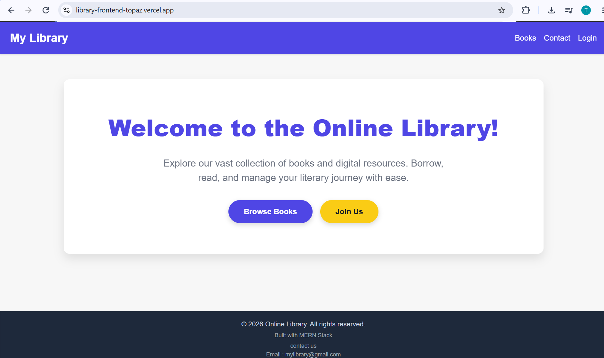
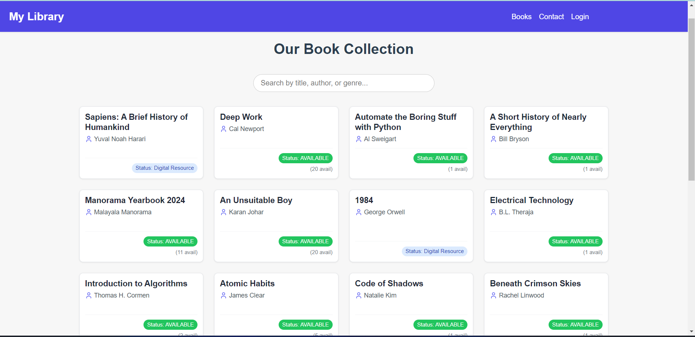
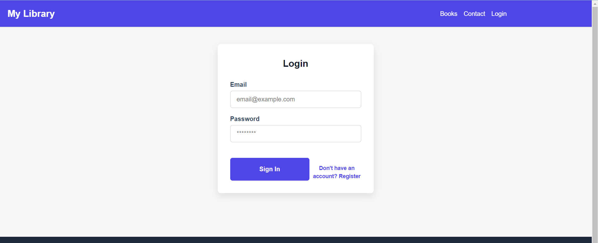
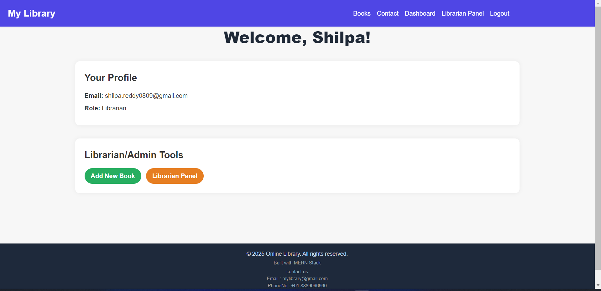

# Online Library Management System

A full-stack MERN application for book discovery, catalogue management, authentication, borrowing workflows, digital resources, and notifications.

<p align="center">
  
  
  
  
  
</p>

<p align="center">
  <strong>Discover books. Manage library records. Simplify library workflows.</strong>
</p>

<p align="center">
  <a href="https://library-management-system-mern-iota.vercel.app/">Live Application</a> ·
  <a href="https://github.com/shilpa8899/Library-Management-System-MERN">GitHub Repository</a> ·
  <a href="https://library-management-backend-wnl2.onrender.com/api">Backend API</a>
</p>

---

## Table of Contents

- [Overview](#overview)
- [Problem Statement](#problem-statement)
- [Features](#features)
- [Technology Stack](#technology-stack)
- [System Architecture](#system-architecture)
- [Project Structure](#project-structure)
- [Screenshots](#screenshots)
- [Live Deployment](#live-deployment)
- [Getting Started](#getting-started)
- [Environment Variables](#environment-variables)
- [API Route Groups](#api-route-groups)
- [Deployment Configuration](#deployment-configuration)
- [Security](#security)
- [Testing Checklist](#testing-checklist)
- [Known Limitations](#known-limitations)
- [Future Improvements](#future-improvements)
- [Author](#author)

---

## Overview

The **Online Library Management System** is a full-stack web application built using the MERN stack. It provides a browser-based interface for discovering books and accessing supported library-management workflows.

The frontend uses React and Vite. It communicates with a Node.js and Express backend through HTTP API requests. MongoDB Atlas provides persistent data storage, with Mongoose supporting database operations.

The frontend and backend are maintained in a single GitHub repository and deployed independently using Vercel and Render.

## Problem Statement

Library members need a convenient way to discover books and access available library services. Library staff also need tools to maintain book records and manage supported library operations.

This project brings these workflows together in one web application, helping make catalogue access and library operations easier to manage.

## Features

- **User Authentication:** Registration and login workflows.
- **Book Catalogue:** Browse and search book records.
- **User Management:** User-related operations.
- **Borrowing Management:** Borrowing-related workflows.
- **Digital Resources:** Digital resource functionality.
- **Notifications:** Notification-related functionality.
- **Role-Based Access Control:** Middleware for protecting authorized operations.
- **Semantic Book Discovery:** Discover books using semantic search, where configured.
- **Personalized Book Recommendations:** Recommend books based on supported recommendation logic.
- **Responsive User Interface:** A React-based interface for interacting with the application.

> Feature availability depends on the implementation and production configuration. Verify individual workflows in the deployed application before describing them as fully operational.

## Technology Stack

| Layer | Technologies |
|---|---|
| Frontend | React.js, JavaScript, CSS |
| Frontend Tooling | Vite |
| API Client | Axios |
| Backend | Node.js, Express.js |
| Database | MongoDB Atlas |
| ODM | Mongoose |
| Authentication | JWT, where configured |
| Semantic Search | Embeddings and MongoDB Atlas Vector Search, where configured |
| Frontend Hosting | Vercel |
| Backend Hosting | Render |
| Version Control | Git and GitHub |

## System Architecture

```text
                    User / Browser
                          |
                          v
                  React + Vite Frontend
                        (Vercel)
                          |
                          v
                     Axios Client
                          |
                          v
                    HTTPS API Calls
                          |
                          v
                  Node.js + Express API
                        (Render)
                          |
                          v
                       Mongoose
                          |
                          v
                     MongoDB Atlas
```

### Request Flow

1. The user interacts with the frontend.
2. Axios sends HTTP requests to the configured backend API.
3. Express routes requests to the appropriate handlers.
4. The backend performs business logic and database operations.
5. The backend returns responses to the frontend.
6. The frontend displays the resulting data or appropriate error messages.

## Project Structure

```text
Library-Management-System-MERN/
│
├── Library_Backend/
│   ├── config/
│   ├── controllers/
│   ├── jobs/
│   ├── middleware/
│   ├── models/
│   ├── routes/
│   ├── scripts/
│   ├── services/
│   ├── utils/
│   ├── package.json
│   └── server.js
│
├── Library_Frontend/
│   ├── public/
│   ├── images/
│   ├── src/
│   │   ├── assets/
│   │   ├── components/
│   │   ├── context/
│   │   ├── hooks/
│   │   ├── pages/
│   │   ├── utils/
│   │   ├── App.jsx
│   │   └── main.jsx
│   ├── package.json
│   ├── vite.config.js
│   └── index.html
│
├── .gitignore
└── README.md
```

> This is a high-level representation. Update the structure if your actual repository differs.

## Screenshots

### Home Page



### Book Catalogue and Discovery



### Book Details



### Application Interface



> Ensure the screenshot files exist at these paths in your repository. Update the paths to match the actual filenames if necessary.

## Live Deployment

| Component | Link |
|---|---|
| Live Application | [Open Frontend](https://library-management-system-mern-iota.vercel.app/) |
| Backend API Base URL | [Open Backend API](https://library-management-backend-wnl2.onrender.com/api) |
| GitHub Repository | [View Source Code](https://github.com/shilpa8899/Library-Management-System-MERN) |

The frontend is hosted on Vercel, and the backend is hosted on Render.

## Getting Started

### Prerequisites

Install the following:

- [Node.js](https://nodejs.org/)
- npm
- [Git](https://git-scm.com/)
- A MongoDB Atlas account or another supported MongoDB instance
- Credentials for external services required by the application

### 1. Clone the Repository

```bash
git clone https://github.com/shilpa8899/Library-Management-System-MERN.git
cd Library-Management-System-MERN
```

### 2. Set Up the Backend

Navigate to the backend directory:

```bash
cd Library_Backend
```

Install dependencies:

```bash
npm install
```

Create a `.env` file inside `Library_Backend` and configure the environment variables required by the backend.

Start the backend using the script configured in `package.json`:

```bash
npm start
```

If the `start` script is not available, check the scripts in `package.json` and use the appropriate server entry point.

### 3. Set Up the Frontend

Open a second terminal and navigate to the frontend directory from the repository root:

```bash
cd Library_Frontend
```

Install dependencies:

```bash
npm install
```

Create a `.env` file inside `Library_Frontend`:

```env
VITE_API_BASE_URL=http://localhost:5000/api
```

Replace port `5000` with the actual local backend port if it differs.

Start the frontend development server:

```bash
npm run dev
```

Open the local URL displayed in the terminal.

### 4. Build the Frontend

From `Library_Frontend`, run:

```bash
npm run build
```

Vite generates the production build in the `dist` directory.

## Environment Variables

Configure environment variables locally and in the relevant hosting dashboards. Use the exact variable names referenced by your code.

### Backend — Render

Depending on the features enabled, the backend may require:

| Variable | Purpose |
|---|---|
| `MONGO_URI` | MongoDB connection string |
| `JWT_SECRET` | JWT signing secret, if used |
| `GEMINI_API_KEY` | Gemini API access, if enabled |
| `EMBEDDING_MODEL` | Embedding model configuration, if used |
| `MONGODB_VECTOR_INDEX` | Vector search index name, if used |
| `SMTP_HOST` | SMTP server hostname, if email is configured |
| `SMTP_PORT` | SMTP server port |
| `SMTP_USER` | SMTP account username |
| `SMTP_PASS` | SMTP password or app password |
| `EMAIL_FROM` | Sender address, if configured |

Only configure variables that are actually required by your backend.

### Frontend — Vercel

If the frontend reads `import.meta.env.VITE_API_BASE_URL`, configure:

```env
VITE_API_BASE_URL=https://library-management-backend-wnl2.onrender.com/api
```

This directs frontend API requests to the deployed backend.

After changing environment variables in Vercel, redeploy the frontend for the updated values to take effect.

**Security note:** Variables prefixed with `VITE_` are exposed to client-side code. Never place database credentials, JWT secrets, SMTP passwords, or other private secrets in frontend environment variables.

## API Route Groups

The backend contains the following route groups:

| API Prefix | Purpose |
|---|---|
| `/api/auth` | Authentication |
| `/api/users` | User operations |
| `/api/books` | Book catalogue operations |
| `/api/borrowings` | Borrowing operations |
| `/api/digital-resources` | Digital resource operations |
| `/api/notifications` | Notification operations |

The supported HTTP methods, request formats, response structures, and authorization requirements are defined by the backend implementation.

## Deployment Configuration

### Backend — Render

- **Repository:** `Library-Management-System-MERN`
- **Root Directory:** `Library_Backend`
- **Build Command:** `npm install`
- **Start Command:** Use the start script configured in `Library_Backend/package.json`.
- **Environment Variables:** Configure the database connection, authentication secrets, and any required external service credentials.

### Frontend — Vercel

- **Repository:** `Library-Management-System-MERN`
- **Root Directory:** `Library_Frontend`
- **Framework Preset:** Vite
- **Build Command:** `npm run build`
- **Output Directory:** `dist`
- **Environment Variable:** `VITE_API_BASE_URL=https://library-management-backend-wnl2.onrender.com/api`, if used by your frontend code.

### CORS Configuration

The backend must allow requests from the deployed frontend origin:

```text
https://library-management-system-mern-iota.vercel.app
```

Configure CORS to allow the origin expected by your application. Avoid unrestricted origins in production unless specifically required.

## Security

- Never commit `.env` files, database credentials, passwords, or API secrets.
- Keep environment files excluded through `.gitignore`.
- Validate user input on the backend.
- Enforce authorization on protected API routes.
- Do not rely solely on frontend restrictions for access control.
- Store credentials in the appropriate hosting environment settings.
- Rotate any credential that is accidentally exposed.
- Review CORS configuration, token handling, and error responses before production use.

## Testing Checklist

Verify the deployed application before marking a workflow as complete.

- [ ] Frontend loads successfully.
- [ ] Frontend requests reach the deployed backend.
- [ ] Registration and login work correctly.
- [ ] Book catalogue and search work correctly.
- [ ] Borrowing and returning workflows work as expected.
- [ ] Protected routes enforce authorization.
- [ ] Data persists after refreshing the application.
- [ ] API failures are handled correctly.
- [ ] Semantic book discovery works end to end.
- [ ] Personalized book recommendations work as expected.
- [ ] Email notifications work end to end, if configured.
- [ ] No credentials or secret files are committed to GitHub.

## Known Limitations

- Free-tier hosting may introduce cold starts or provider-specific restrictions.
- External integrations depend on valid credentials and service availability.
- Email delivery should be considered operational only after successful end-to-end testing.
- Individual features should be verified in the deployed environment before being described as fully functional.

## Future Improvements

- **Automated Testing:** Add unit and integration tests for authentication, catalogue management, and borrowing workflows.
- **Performance Optimization:** Optimize database queries, API response times, and frontend loading performance.
- **Monitoring and Logging:** Introduce structured logging and error monitoring to simplify debugging and maintenance.
- **Reliable Email Notifications:** Improve production email delivery and verify borrowing confirmations, due-date reminders, and return notifications, if these workflows still need improvement.
- **Enhanced Accessibility:** Improve keyboard navigation, accessibility, and responsive layouts where needed.

## Author

**Shilpa Palli**

- **GitHub Profile:** [shilpa8899](https://github.com/shilpa8899)
- **Project Repository:** [Library-Management-System-MERN](https://github.com/shilpa8899/Library-Management-System-MERN)
- **Live Application:** [Online Library Management System](https://library-management-system-mern-iota.vercel.app/)
- **Backend API:** [Render Backend](https://library-management-backend-wnl2.onrender.com/api)

---

<p align="center">
  Built with React, Node.js, Express, and MongoDB.
</p>
